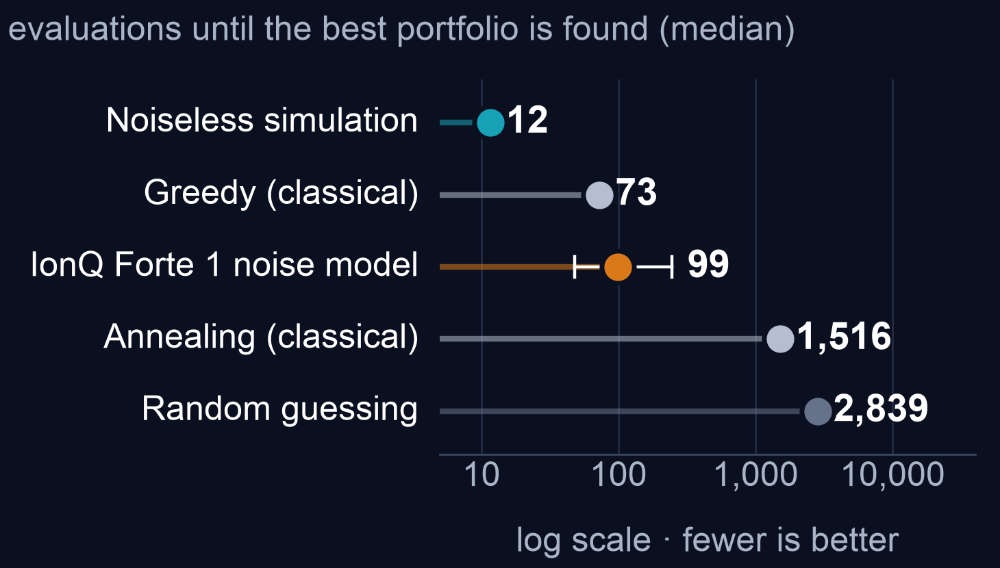

# Portfolio selection with QAOA on IonQ

**This effort is supported by Qollab & IonQ.**

Which stocks should a fund buy? This project turns the question into an Ising problem with one qubit per asset and samples it with QAOA on the IonQ Forte 1 noise model. Every result is compared with the exact answer, random guessing and classical search.

Team ZollerQu (Oussama Turki, Tushar Pandey) · Qollab × IonQ Hackathon, 9–11 October 2026 · theme: Quantum Impact · MIT licence

This is one of four ZollerQu projects; the [`main` branch](https://github.com/Oussema-t/zollerqu-qollab) has the overview of all of them.



## Documents

| Document | What it is |
|---|---|
| [paper/zollerqu_stock_qaoa.pdf](paper/zollerqu_stock_qaoa.pdf) | 7-page paper with every method and result |
| [slides/stocks_ZollerQu.pdf](slides/stocks_ZollerQu.pdf) | 11-slide deck for the 3-minute video ([script](slides/video_script_3min.md)) |
| [stocks/stock_idea_ZollerQu.ipynb](stocks/stock_idea_ZollerQu.ipynb) | Notebook with every experiment, run top to bottom with outputs |
| [qollab/main.py](qollab/main.py) | The single file that runs on Qollab |
| [stocks/EXPERIMENTS_SUMMARY.md](stocks/EXPERIMENTS_SUMMARY.md) | Short list of all experiments |

## The problem

Funds want low risk and a good return. Risk comes from assets that fall together. Every extra asset doubles the number of possible portfolios: 12 assets give 4,096 portfolios, 29 assets give 536,870,912.

## Approach

- **Data:** weekly prices of 12 US stocks and funds, 2006–2014: AAPL, GLD, XOM, JPM, TLT, JNJ, PG, XLU, VNQ, FCX, MSFT, SLV.
- **Encoding:** one qubit per asset; 0 means buy, 1 means skip. Risk minus return becomes an Ising energy with one coupling per pair of assets. The lowest energy is the best portfolio.
- **Exact answer:** all 4,096 portfolios are checked classically. The best one is Apple plus US Treasury bonds (AAPL + TLT).
- **Circuits:** 8 circuit types (58 circuits) compared in noiseless simulation: linear-ramp QAOA, free-angle QAOA with 5 optimisers, CVaR-QAOA, multi-angle QAOA, counterdiabatic QAOA, XY-mixer QAOA and two imaginary-time methods. All angles are trained offline; the Qollab code only builds and runs the chosen circuit.
- **Best circuit at 12 qubits:** CVaR-QAOA with 3 layers (198 two-qubit gates). At 16 to 29 qubits: linear-ramp QAOA with a ramp tuned at 12 qubits, with no new training.

## Why IonQ

Trapped ions connect every pair of qubits directly, so one QAOA layer at 12 qubits needs 66 two-qubit gates and no SWAPs. The same layer transpiled to a heavy-hex map needs 285 (4.3 times more); at 29 qubits the ratio is 6.5. These are gate counts from the Qiskit transpiler only; no circuit was run on a heavy-hex device.

## Results

Each row says how it was obtained: on the **IonQ noise model** (IonQ's noisy simulator, Forte 1 noise model, through Qollab) or in **noiseless** simulation.

| Experiment | Run type | Result |
|---|---|---|
| CVaR-QAOA, 3 layers, 12 qubits, 1,000 shots | IonQ noise model | 7 of 1,000 shots are the exact best portfolio (95 % interval 3–14) |
| Same, against random guessing | IonQ noise model | 29 times more often (random: 0.24 per 1,000) |
| Same circuit without noise | noiseless | 58 per 1,000, so noise costs a factor of 8 |
| Evaluations until the best portfolio is found (median) | mixed | greedy search 73 · IonQ run 99 · simulated annealing 1,516 · random 2,839 |
| 29 assets: best portfolio found within 1,000 shots | noiseless | 3 layers 6.6 % of runs · 16 layers 90 % · 24 layers 99.6 % |
| 29 assets: classical search with 1,000 evaluations | classical | 61 % of runs (100 % with 10,000 evaluations) |

### Settings that mattered (noiseless)

| Setting | Change | Effect |
|---|---|---|
| Mixer sign, 12 assets | as written → opposite sign | 0.004 % → 1.8 % per shot |
| Objective, 12 assets | mean energy → CVaR 0.1 | 1.8 % → 5.8 % per shot |
| Layers, 29 assets | 3 → 16 | 6.6 % → 90 % of runs |
| Ramp range, 29 assets, 16 layers | up to 1.5 → up to 3.0 | 45 % → 90 % of runs |

### Iceberg error detection

The same QAOA circuit also runs inside the Iceberg error-detection code: 12 logical qubits on 14, plus 1 flag qubit and 2 helper qubits, 17 qubits in total.

- **Verified by fault injection** (`stocks/verify_iceberg.py`): all 5,904 single faults were injected in exact simulation. Every fault in state preparation, in the checks and in the readout is caught; 80 % of the faults on the QAOA gates are caught or harmless. The rest are XX, YY and ZZ errors on a gate's own pair, which a distance-2 code cannot see.
- **On the IonQ noise model** (1 layer, 1,000 shots): 246 shots passed every check (25 %); 3 in 4 were flagged and discarded. The best portfolio appeared in 2 of the 246 kept shots (8 per 1,000). Plain QAOA gave 5 and 11 per 1,000 on the same noise model, so the kept shots are not clearly better. The reason is the cost: 133 two-qubit gates instead of 66.

A note on the record: in the first multi-job sweeps on Qollab only one job per run reached IonQ, and the others were replaced by local noiseless samples. This was found and fixed, and those samples are marked as local in `results/qollab_iceberg_sweeps_20261011.json`. The Iceberg result above is from a job that did run on IonQ.

## Honest limits

- All IonQ results come from the noise-model simulator, not from a real quantum computer, with one job of 1,000 shots per result.
- Classical heuristics match or beat the circuit at these sizes. No quantum advantage is claimed.
- The 29-asset results are noiseless simulations. 16 layers need 6,496 two-qubit gates, far beyond what today's noise allows.
- Angles are trained offline on a classical simulator; that training cost is not counted in the comparison.
- Iceberg is error detection, not error correction: failed shots are thrown away, nothing is repaired.

## Run it on Qollab

1. Paste [qollab/main.py](qollab/main.py) into a Qollab project and press **Run**.
2. In **Select QPU**, choose **IonQ Forte 1 (29q) noise model**.
3. With the default fields, one Run sends one job: linear-ramp QAOA with 1 layer, protected by Iceberg. It prints the kept shots, a results table and plots.

| Field | Default | Meaning |
|---|---|---|
| `layers` | `1` | number of QAOA layers (1–6, 8, 10, 12 or 16) |
| `error_detection` | `iceberg` | `none`, `iceberg` or `both` |
| `circuit` | `B_lr` | `B_lr` (linear ramp) or a fixed circuit such as `B_cvar_p3` (the main result) |
| `shots` | `1000` | shots per job |

To repeat the main result, set `circuit = B_cvar_p3` and `error_detection = none`. Qollab runs one IonQ job at a time, so run each setting with its own Run press. Without a backend the code samples the exact noiseless distribution locally and says so in the output.

## Run it locally

```bash
python3.12 -m venv venv
venv/bin/pip install qiskit==2.5.2 numpy scipy matplotlib pandas numba
venv/bin/python -m pytest tests -q          # 126 tests
venv/bin/python qollab/main.py              # local noiseless run of the Qollab code
venv/bin/python -m stocks.verify_iceberg    # fault-injection check of the Iceberg circuits
```

## Repository layout

| Path | Content |
|---|---|
| `stocks/` | Python package: data, Ising model, QAOA circuits and simulators, classical solvers, experiments |
| `qollab/` | `main.py` for Qollab and the selected circuits it is generated from |
| `results/` | Every result as a file (JSON, tables, figures), including the recorded IonQ runs |
| `paper/`, `slides/` | The paper and the deck; every number is generated from the result files |
| `data/` | Weekly prices and their licence notes |
| `tests/` | Unit tests for the Ising model, simulators, data and classical solvers |

## Credits and licences

- **Licence:** MIT, see [LICENSE](LICENSE).
- **Data:** Kaggle "Huge Stock Market Dataset" by Boris Marjanovic, CC0 public domain. The `data/` folder also contains OR-Library index-tracking data (J. E. Beasley) with its licence notice, used during development.
- **Libraries:** Qiskit 2.5.2, NumPy, SciPy, Matplotlib; offline analysis also uses Qiskit Aer and Numba.
- **Papers:**
  - Linear-ramp QAOA: J. A. Montañez-Barrera and K. Michielsen, npj Quantum Information 11, 131 (2025).
  - Iceberg code: C. N. Self, M. Benedetti and D. Amaro, Nature Physics 20, 219 (2024).
  - CVaR objective: P. Barkoutsos et al., Quantum 4, 256 (2020).
  - Variational imaginary-time evolution: IonQ and ORNL, arXiv:2404.16135.
  - Portfolio optimisation on IonQ hardware: IonQ and Kipu Quantum, arXiv:2602.23976.
- **AI tools:** Claude Code (Anthropic) was used for code, analysis, figures, slides and the paper. The team chose the problem and methods and reviewed the results.
