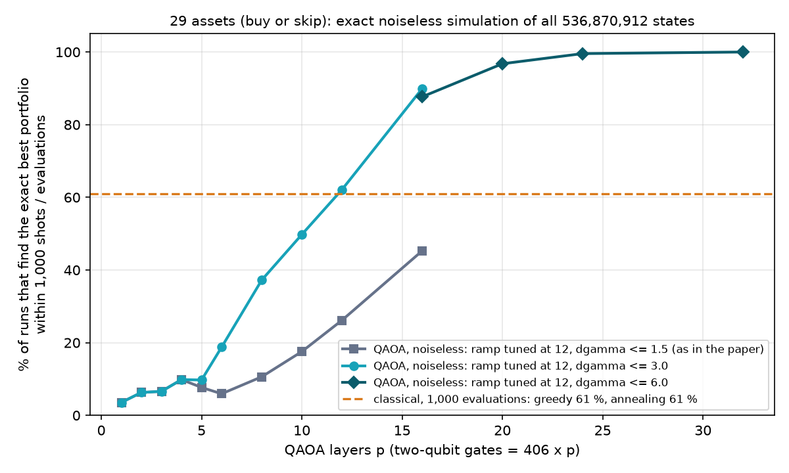

# 29 assets: what improves QAOA (exact noiseless experiment, 11 Oct 2026)

**Question.** The 29-asset circuit in the paper and the deck (linear ramp tuned at 12 assets, 3 layers) finds the exact best portfolio within 1,000 shots in only 6.6 % of runs, while greedy descent and simulated annealing find it in 61 % of runs with 1,000 evaluations. Which changes genuinely help?

**Short answer.** Depth, with the ramp still tuned at 12 assets, is the change that matters. Re-tuning, optimisers, objectives and starts move the 3-layer circuit from 6.6 % to at most 18 %. Going from 3 to 16 layers moves it to 90 %, and 24 layers to 99.6 %, without spending a single 29-qubit circuit on tuning. All of this is **noiseless simulation of very deep circuits** (6,496 to 12,992 two-qubit gates); it says nothing about today's noisy hardware, and no quantum advantage is claimed (see "What this does not show").

## Setup (kept fixed)

- **Problem:** the same Hamiltonian as in the paper: buy-or-skip, η = 1, 2006–2014 training data, all 406 pairs of the 29 assets, no balance term. Exact optimum by enumerating all 536,870,912 portfolios (one optimal state: buy AAPL, GLD, TLT, JNJ, IEF, KO, SHY).
- **Simulator:** `stocks/fast_sim.py`, an exact statevector (complex64, multi-threaded with numba). It reproduces the recorded 29-asset results to 7 significant digits (p = 1–3) and agrees with the double-precision reference simulator to 5 parts per million at 16 and 32 layers (20 assets). Unit tests: `tests/test_fast_sim.py` (4 tests, passed on the server; skipped locally where numba is not installed).
- **Grading (same for every circuit):** P(best) per shot, and the probability that 1,000 (or 10,000) shots contain the best portfolio, computed exactly as 1 − (1 − P)^B, so there is no sampling noise in these numbers. "Quality" is (E_max − ⟨E⟩)/(E_max − E_min).
- **No cheating in angle choice:** angles are chosen only by quantities a device can measure from shots (expected energy, CVaR 0.1, or a finite-shot average). Rows marked ORACLE use the known optimum and are shown for reference only.
- **Budget accounting:** "29-qubit circuits spent on tuning" counts every 29-asset circuit evaluated to choose the angles. Ramps "tuned at 12" cost only 12-asset simulations (300–600 grid points per depth, seconds of classical compute).
- **Classical baselines:** the same greedy descent (restarted) and simulated annealing (one run) as in the paper, 200 runs per budget, graded on the same exact optimum.
- **Compute:** two Hetzner servers (8 and 16 cores), about 1 h 15 min; both deleted after the run. Simulation time per 29-asset circuit on 16 cores: 10 s (3 layers) to 82 s (32 layers). This is simulation cost, not a quantum run time.

## Findings, one factor at a time (3 layers unless stated)

| Change | Best found in 1,000 shots | 29-qubit tuning circuits | Verdict |
|---|---|---|---|
| Baseline (paper): ramp tuned at 12 | 6.6 % | 0 | reference |
| Ramp re-tuned at 29 on a grid, picked by expected energy | 9.9 % | 30 | small gain |
| Same grid, picked by CVaR 0.1 | 17.9 % | 30 | best 3-layer result; it picked the same point as the oracle |
| Optimiser on all 6 angles (COBYLA / L-BFGS-B / Nelder-Mead) | 13.1 / 11.9 / 11.5 % | 40 | small gain, optimisers similar |
| SPSA, two seeds | 9.2 % and 3.1 % | 39 | unreliable: one seed ended below its start |
| COBYLA with CVaR 0.1 as objective | 15.3 % | 40 | CVaR beats the mean energy again |
| COBYLA on a finite-shot energy (1,000 shots: two seeds; 10,000 shots) | 11.0 / 10.9 / 10.5 % | 38–40 | shot noise costs little at this budget |
| COBYLA from a random start (two seeds) | 7.1 / 7.7 % | 40 | worse than starting from the 12-asset ramp |
| **Depth, ramp tuned at 12, no 29-qubit tuning** | **62 % (12 layers), 90 % (16), 97 % (20), 99.6 % (24), 100 % (32)** | **0** | **the lever** |
| Depth 16 + ramp re-tuned at 29 (18 circuits), picked by energy / by CVaR | 96.4 % / 99.5 % | 18 | depth and re-tuning add up |

Two details behind the depth result:
1. **The grid width matters.** The 12-asset tuning in the paper only searched ramp strengths up to 1.5. Deeper circuits want larger ones (2.4–3.2). With the old limit, 16 layers reach only 45 %; with the wider grid, 90 %.
2. **The best ramp drifts slowly with size.** At 8 layers the chosen ramp strength is 2.4 at 12 assets, 2.5 at 16 and 2.6 at 20. The 29-asset re-tune at 16 layers chose 3.6 against 2.8 from 12 assets, so tuning at a size closer to 29 could add a little more.

**Robustness (a second problem, long/short).** The same recipe on the harder long/short problem: 0.1 % at 3 layers, 3.6 % at 8, 37 % at 16, 98 % at 24 and 100 % at 32 layers, all with the ramp tuned at 12 assets. Classical at 1,000 evaluations: greedy 1.5 %, annealing 3.5 %; at 100,000 evaluations: 89.5 % and 98 %.

## Same budget, side by side (buy or skip, 29 assets)

| Method | 100 | 1,000 | 10,000 shots or evaluations |
|---|---|---|---|
| QAOA, 3 layers (paper) | 0.7 % | 6.6 % | 49.5 % |
| QAOA, 16 layers, ramp tuned at 12 | 20.5 % | 89.9 % | 100 % |
| QAOA, 24 layers, ramp tuned at 12 | 41.9 % | 99.6 % | 100 % |
| Greedy descent (restarted) | 0 % | 61 % | 100 % |
| Simulated annealing (one run) | 1.5 % | 61 % | 100 % |
| Random sampling | 0 % | 0 % | 0 % |

The QAOA values at 100 shots are 1 − (1 − P)^100 from the P(best) per shot in the tables below.

## What this does not show

- **Noise.** Every number here is noiseless. Our only noisy run (12 assets, 198 two-qubit gates, IonQ Forte 1 noise model) lost a factor 8 against its noiseless value. The circuits that win here have 6,496 to 12,992 two-qubit gates, 33 to 66 times more. With the crude assumption of 99.5 % success per two-qubit gate used elsewhere in this project, 6,496 gates leave about 10⁻¹⁴ of the signal. These circuits cannot run usefully on today's noisy machines.
- **A shot is not the same work as a classical evaluation.** One shot of a 16-layer circuit needs 6,496 two-qubit gates; one classical evaluation is a few hundred multiplications. The "same budget" compares samples, not cost.
- **The classical side is simple.** Greedy and annealing are the untuned baselines from the paper. Stronger heuristics (annealing with restarts and a tuned schedule, tabu search) were not tested, and enumerating all portfolios solves this instance exactly in seconds on one server.
- **One data set and one risk–return weight (η = 1), two problem types.** Other data windows or weights were not tested.
- **Optimiser runs used 40 circuits each.** With far more circuits (the 12-asset tuning allowed 600) the 3-layer optimisers might do better; we capped them because each 29-asset circuit costs 10–80 s to simulate.
- **No quantum advantage is claimed.**

## Files

- `results/exp29/out_*.jsonl`: one JSON line per job (every circuit's angles and metrics; optimiser runs keep their full trajectory).
- `results/exp29/jobs_run/`: the exact job files that were run. `results/exp29/logs/`: server logs.
- `results/stocks_exp29_summary.json`: all rows in one file. `results/exp29/tables.md`: the full tables below, generated from the files.
- `results/stocks_exp29_classical_buy_or_skip.json`, `results/stocks_exp29_classical_long_short.json`: classical baselines at 100 to 100,000 evaluations.
- `results/figures/exp29_depth.png`: the figure above.

Reproduce: `python -m stocks.exp29 run <job file> <out file>` (needs numba, ~8 GB RAM per 29-asset job), `python -m stocks.exp29 classical 29 buy_or_skip <out>`, then `python -m stocks.exp29_report`.

## Full tables

### Baseline: the ramp tuned at 12 assets, as in the paper

| Circuit | Layers | Two-qubit gates | 29-qubit circuits spent on tuning | P(best) per shot | Best found in 1,000 shots | in 10,000 | Quality |
|---|---|---|---|---|---|---|---|
| ramp tuned at 12 (as used in the paper), p=1 | 1 | 406 | 0 | 3.62e-05 | 3.6 % | 30.4 % | 0.9650 |
| ramp tuned at 12 (as used in the paper), p=2 | 2 | 812 | 0 | 6.50e-05 | 6.3 % | 47.8 % | 0.9730 |
| ramp tuned at 12 (as used in the paper), p=3 | 3 | 1,218 | 0 | 6.83e-05 | 6.6 % | 49.5 % | 0.9733 |
| ramp tuned at 12 (as used in the paper), p=4 | 4 | 1,624 | 0 | 1.04e-04 | 9.8 % | 64.5 % | 0.9762 |
| ramp tuned at 12 (as used in the paper), p=5 | 5 | 2,030 | 0 | 7.99e-05 | 7.7 % | 55.0 % | 0.9736 |

### Factor 1: ramp re-tuned at 29 assets (3 layers)

| Circuit | Layers | Two-qubit gates | 29-qubit circuits spent on tuning | P(best) per shot | Best found in 1,000 shots | in 10,000 | Quality |
|---|---|---|---|---|---|---|---|
| ramp grid at 29, ORACLE best P(opt) (2.4, -0.45) | 3 | 1,218 | 30 | 1.97e-04 | 17.9 % | 86.1 % | 0.9692 |
| ramp grid at 29, lowest CVaR 0.1 (2.4, -0.45) | 3 | 1,218 | 30 | 1.97e-04 | 17.9 % | 86.1 % | 0.9692 |
| ramp grid at 29, lowest expectation (1.7, -0.6) | 3 | 1,218 | 30 | 1.04e-04 | 9.9 % | 64.7 % | 0.9748 |

### Factor 2: optimiser over all 6 angles (3 layers, 40 circuits, start = ramp tuned at 12)

| Circuit | Layers | Two-qubit gates | 29-qubit circuits spent on tuning | P(best) per shot | Best found in 1,000 shots | in 10,000 | Quality |
|---|---|---|---|---|---|---|---|
| COBYLA, ramp tuned at 12, objective expectation, seed 2026 | 3 | 1,218 | 40 | 1.40e-04 | 13.1 % | 75.3 % | 0.9782 |
| L-BFGS-B, ramp tuned at 12, objective expectation, seed 2026 | 3 | 1,218 | 40 | 1.27e-04 | 11.9 % | 71.8 % | 0.9765 |
| Nelder-Mead, ramp tuned at 12, objective expectation, seed 2026 | 3 | 1,218 | 40 | 1.22e-04 | 11.5 % | 70.5 % | 0.9774 |
| SPSA, ramp tuned at 12, objective expectation, seed 2026 | 3 | 1,218 | 39 | 9.68e-05 | 9.2 % | 62.0 % | 0.9740 |
| SPSA, ramp tuned at 12, objective expectation, seed 2027 | 3 | 1,218 | 39 | 3.16e-05 | 3.1 % | 27.1 % | 0.9655 |

### Factor 3: tuning objective

| Circuit | Layers | Two-qubit gates | 29-qubit circuits spent on tuning | P(best) per shot | Best found in 1,000 shots | in 10,000 | Quality |
|---|---|---|---|---|---|---|---|
| COBYLA, ramp tuned at 12, objective cvar_0.1, seed 2026 | 3 | 1,218 | 40 | 1.67e-04 | 15.3 % | 81.1 % | 0.9748 |

### Factor 4: finite shots per tuning circuit

| Circuit | Layers | Two-qubit gates | 29-qubit circuits spent on tuning | P(best) per shot | Best found in 1,000 shots | in 10,000 | Quality |
|---|---|---|---|---|---|---|---|
| COBYLA, ramp tuned at 12, objective shots_1000, seed 2026 | 3 | 1,218 | 38 | 1.16e-04 | 11.0 % | 68.7 % | 0.9762 |
| COBYLA, ramp tuned at 12, objective shots_1000, seed 2027 | 3 | 1,218 | 40 | 1.15e-04 | 10.9 % | 68.5 % | 0.9754 |
| COBYLA, ramp tuned at 12, objective shots_10000, seed 2026 | 3 | 1,218 | 40 | 1.11e-04 | 10.5 % | 67.0 % | 0.9765 |

### Factor 5: initialisation (random start instead of the ramp)

| Circuit | Layers | Two-qubit gates | 29-qubit circuits spent on tuning | P(best) per shot | Best found in 1,000 shots | in 10,000 | Quality |
|---|---|---|---|---|---|---|---|
| COBYLA, random start, seed 1, objective expectation, seed 2026 | 3 | 1,218 | 40 | 7.37e-05 | 7.1 % | 52.2 % | 0.9807 |
| COBYLA, random start, seed 2, objective expectation, seed 2026 | 3 | 1,218 | 40 | 8.00e-05 | 7.7 % | 55.1 % | 0.9727 |

### Factor 6: depth (ramp tuned at 12 assets, no tuning at 29)

| Circuit | Layers | Two-qubit gates | 29-qubit circuits spent on tuning | P(best) per shot | Best found in 1,000 shots | in 10,000 | Quality |
|---|---|---|---|---|---|---|---|
| ramp tuned at 12 on the wide grid (dgamma up to 3.0), p=5 | 5 | 2,030 | 0 | 1.02e-04 | 9.7 % | 64.1 % | 0.9761 |
| ramp tuned at 12 on the original grid (dgamma up to 1.5), p=6 | 6 | 2,436 | 0 | 6.12e-05 | 5.9 % | 45.8 % | 0.9723 |
| ramp tuned at 12 on the wide grid (dgamma up to 3.0), p=6 | 6 | 2,436 | 0 | 2.08e-04 | 18.8 % | 87.5 % | 0.9804 |
| ramp tuned at 12 on the original grid (dgamma up to 1.5), p=8 | 8 | 3,248 | 0 | 1.12e-04 | 10.6 % | 67.4 % | 0.9772 |
| ramp tuned at 12 on the wide grid (dgamma up to 3.0), p=8 | 8 | 3,248 | 0 | 4.66e-04 | 37.2 % | 99.1 % | 0.9838 |
| ramp tuned at 12 on the original grid (dgamma up to 1.5), p=10 | 10 | 4,060 | 0 | 1.93e-04 | 17.6 % | 85.5 % | 0.9804 |
| ramp tuned at 12 on the wide grid (dgamma up to 3.0), p=10 | 10 | 4,060 | 0 | 6.88e-04 | 49.8 % | 99.90 % | 0.9851 |
| ramp tuned at 12 on the original grid (dgamma up to 1.5), p=12 | 12 | 4,872 | 0 | 3.03e-04 | 26.2 % | 95.2 % | 0.9827 |
| ramp tuned at 12 on the wide grid (dgamma up to 3.0), p=12 | 12 | 4,872 | 0 | 9.70e-04 | 62.1 % | > 99.99 % | 0.9871 |
| ramp tuned at 12 on the deep grid, p=16 | 16 | 6,496 | 0 | 2.09e-03 | 87.7 % | > 99.99 % | 0.9894 |
| ramp tuned at 12 on the original grid (dgamma up to 1.5), p=16 | 16 | 6,496 | 0 | 6.03e-04 | 45.3 % | 99.76 % | 0.9854 |
| ramp tuned at 12 on the wide grid (dgamma up to 3.0), p=16 | 16 | 6,496 | 0 | 2.29e-03 | 89.9 % | > 99.99 % | 0.9896 |
| ramp tuned at 12 on the deep grid, p=20 | 20 | 8,120 | 0 | 3.43e-03 | 96.8 % | 100 % | 0.9908 |
| ramp tuned at 12 on the deep grid, p=24 | 24 | 9,744 | 0 | 5.42e-03 | 99.56 % | 100 % | 0.9926 |
| ramp tuned at 12 on the deep grid, p=32 | 32 | 12,992 | 0 | 1.03e-02 | > 99.99 % | 100 % | 0.9947 |

### Combination: 16 layers + ramp re-tuned at 29

| Circuit | Layers | Two-qubit gates | 29-qubit circuits spent on tuning | P(best) per shot | Best found in 1,000 shots | in 10,000 | Quality |
|---|---|---|---|---|---|---|---|
| ramp grid at 29, ORACLE best P(opt) (3.2, -0.5) | 16 | 6,496 | 9 | 3.06e-03 | 95.3 % | 100 % | 0.9893 |
| ramp grid at 29, ORACLE best P(opt) (4.0, -0.5) (picked over both grids) | 16 | 6,496 | 18 | 5.32e-03 | 99.52 % | 100 % | 0.9892 |
| ramp grid at 29, lowest CVaR 0.1 (3.2, -0.5) | 16 | 6,496 | 9 | 3.06e-03 | 95.3 % | 100 % | 0.9893 |
| ramp grid at 29, lowest CVaR 0.1 (4.0, -0.5) (picked over both grids) | 16 | 6,496 | 18 | 5.32e-03 | 99.52 % | 100 % | 0.9892 |
| ramp grid at 29, lowest expectation (3.2, -0.6) | 16 | 6,496 | 9 | 2.94e-03 | 94.8 % | 100 % | 0.9902 |
| ramp grid at 29, lowest expectation (3.6, -0.7) (picked over both grids) | 16 | 6,496 | 18 | 3.32e-03 | 96.4 % | 100 % | 0.9907 |

### Robustness: the long/short problem (ramp tuned at 12, no tuning at 29)

| Circuit | Layers | Two-qubit gates | 29-qubit circuits spent on tuning | P(best) per shot | Best found in 1,000 shots | in 10,000 | Quality |
|---|---|---|---|---|---|---|---|
| long/short, ramp tuned at 12, p=3 [long_short] | 3 | 1,218 | 0 | 7.74e-07 | 0.1 % | 0.8 % | 0.9464 |
| long/short, ramp tuned at 12, p=8 [long_short] | 8 | 3,248 | 0 | 3.66e-05 | 3.6 % | 30.7 % | 0.9703 |
| long/short, ramp tuned at 12, p=16 [long_short] | 16 | 6,496 | 0 | 4.67e-04 | 37.3 % | 99.1 % | 0.9826 |
| long/short, ramp tuned at 12, p=24 [long_short] | 24 | 9,744 | 0 | 3.92e-03 | 98.0 % | 100 % | 0.9889 |
| long/short, ramp tuned at 12, p=32 [long_short] | 32 | 12,992 | 0 | 1.11e-02 | > 99.99 % | 100 % | 0.9914 |

### Classical baselines, buy or skip (200 runs per budget)

| Budget (evaluations) | Random sampling | Greedy descent (restarted) | Simulated annealing (one run) |
|---|---|---|---|
| 100 | 0.0 % | 0.0 % | 1.5 % |
| 1,000 | 0.0 % | 61.0 % | 61.0 % |
| 10,000 | 0.0 % | 100 % | 100 % |
| 100,000 | 0.0 % | 100 % | 100 % |

### Classical baselines, long/short (200 runs per budget)

| Budget (evaluations) | Random sampling | Greedy descent (restarted) | Simulated annealing (one run) |
|---|---|---|---|
| 100 | 0.0 % | 0.0 % | 0.0 % |
| 1,000 | 0.0 % | 1.5 % | 3.5 % |
| 10,000 | 0.0 % | 19.5 % | 42.0 % |
| 100,000 | 0.0 % | 89.5 % | 98.0 % |

